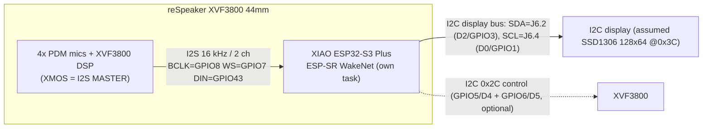

# PLAN 闂?Wake Word 闂?Display Animation Demo
**reSpeaker XVF3800 44mm + XIAO ESP32-S3 Plus + I2C display, Espressif ESP-SR (WakeNet)**

Plan v1 闂?2026-11-16. No code written yet; this file is the deliverable of step 0.
Demo behavior: say **"Hi ESP"** near the array 闂?XIAO detects it with ESP-SR WakeNet 闂?plays a short animation loop on the I2C display, returns to idle.

---

## 1. System architecture (facts verified 2026-11-16)

Verified facts and their sources:

| # | Fact | Source |
| --- | --- | --- |
| 1 | XIAO runs I2S **slave**; XVF3800 is master (drives BCLK/LRCLK/MCLK). RX pins: `pin_bck=8 (D9)`, `pin_ws=7 (D8)`, `pin_data_rx=43 (D6)`. | Seeed wiki "Record and Playback" (respeaker_44mm_xiao_record_playback, upd. 2026-11-04) 闂?working sketch |
| 1b | The I2S bus is **wired on-board** (XIAO D6闂傚倸鍊搁崐鐑芥嚄閸洖纾婚柕濞炬櫅绾惧潡鏌熺紒妯轰刊闁?0 闂?XVF3800) 闂?no external I2S wiring needed, only pin config in code. XIAO **D4/D5 (GPIO5/6) belong to the XMOS I2C control bus (0x2C)** and are not broken out as pads. Free broken-out pads: **D0=GPIO1, D2=GPIO3, D3=GPIO4, D13=GPIO40, D14=GPIO41** (+3V3/GND) 闂?display I2C goes on **J6 pin2 = SDA (D2/GPIO3) + J6 pin4 = SCL (D0/GPIO1)** per fact 11 netlist (not D2/D3 闂?D3 sits on header J5). Note: the 44mm wiki pin table lists "D2 \| GPIO2" 闂?typo; XIAO ESP32-S3 fixed mapping is D2=GPIO3, D1=GPIO2. | 44mm wiki getting-started (XIAO support + pin-out tables) |
| 2 | The 44mm repo ships **`respeaker_44mm_i2s_c16k2ch_v1.0.0.bin`** (16 kHz / 2 ch) and `c48k2ch_v1.0.0.bin`. Using the **16k** firmware means WakeNet's required input rate (16 kHz) is met with **no resampling**. | GitHub API listing of `respeaker/reSpeaker_XVF3800_4MIC_44mm` 闂?`xmos_firmwares/i2s/` (checked 2026-11-16) |
| 3 | WakeNet input spec: **16 kHz, mono, signed 16-bit**; engine sits inside AFE, returns detections via fetch; up to 5 wake words per model; WakeNet9/9l on ESP32-S3. | esp-sr docs (esp32s3/wake_word_engine/README) |
| 4 | Free built-in wake word: **"Hi ESP"**. Custom phrases = Espressif wake-word customization process (separate service, corpus requirements, lead time). | esp-sr docs (getting_started, ESP_Wake_Words_Customization) |
| 5 | Models live in a flash partition labeled `model` (size ~6000K line in partitions.csv per docs; Arduino: regenerate `srmodels.bin` via movemodel.py). Arduino `ESP_SR.h` requires `CONFIG_MODEL_IN_FLASH`. | esp-sr docs (flash_model/README) |
| 6 | Arduino core libraries verified from source: `I2SClass::begin(mode, rate, bits, slot, slot_mask, role=I2S_ROLE_MASTER)` 闂?**slave role supported**; `configureRX(..., I2S_RX_TRANSFORM_32_TO_16 / I2S_RX_TRANSFORM_16_STEREO_TO_MONO)` 闂?hardware-format conversion built in; `ESP_SR.begin(i2s, cmds, len, SR_CHANNELS_MONO/STEREO, SR_MODE_WAKEWORD, input_format="MN")` 闂?channel roles are declared ("M"=mic, "R"=reference, "N"=unused). ESP_SR reads I2S in its own task (`sr_start` fill callback) 闂?**Arduino `loop()` stays free for the display animation**. | arduino-esp32 `ESP_I2S.h`, `ESP_SR.h/.cpp` (master branch, read 2026-11-16) |
| 7 | XIAO ESP32-S3 Plus = 8 MB octal PSRAM (wiki test output: 8388608 B). esp-sr needs PSRAM; Arduino menu: `Tools > PSRAM > OPI PSRAM`, board `XIAO_ESP32S3_Plus`. | Seeed wiki record/playback expected output |
| 8 | The wiki test format was 48 kHz/2 ch/**32-bit**. The 16k firmware's bit width is not stated on the wiki 闂?assumed 32-bit, handled by the built-in RX transform; verified in M0. | Seeed wiki + M0 experiment |
| 9 | Display bandwidth math: SSD1306 128闂?4 full-frame push = 1024 B; at 400 kHz I2C 闂?23 ms/frame 闂?~40 fps ceiling; target animation 20闂?0 fps. | calculation |
| 10 | I2C scan (2026-11-16, 3 rounds: full pad matrix both polarities, 50k闂?00k, 2-pass confirmed): **no device ACKs on any free pad** (D0/D1/D2/D3/D14). Drive-low release test: **no external pull-ups on any free pad** (all stay low after release) 闂?display module not electrically present or unpowered. Internal XMOS bus (GPIO5/6): real device at **0x18** = onboard TLV320-family codec (matches KB entry); XMOS control 0x2C did NOT answer (I2S firmware likely keeps control I2C off). GPIO2/D1 is board-connected (pulls low under traffic) 闂?**not usable as a free pin**. D2 pad = GPIO3 confirmed 闂?wiki row "D2 \| GPIO2" is a typo. | scanner sketches v1闂傚倸鍊搁崐鐑芥嚄閸洖纾婚柕濞炬櫅绾惧潡鏌＄仦璇插姎缂? + recovery test |
| 11 | **KiCad netlist (AUTHORITATIVE, 2026-11-16) 闂?supersedes the earlier PDF-text claim "D0闂傚倸鍊搁崐鐑芥嚄閸洖纾婚柕濞炬櫅绾惧潡鏌熺紒妯轰刊闁? terminate on XMOS", which was WRONG**: `XIAO_D0` = U24.pad1 + J6.pad4 only; `XIAO_D2` = U24.pad3 + J6.pad2 only 闂?free pads, no XMOS, no board pull-ups. `XIAO_D1` = U24.pad2 + J6.pad3 + R22(闂傚倸鍊搁崐鐑芥倿閿曞倸绀堟慨妯挎硾绾惧鏌涘☉鍗炴灓闁绘繂鐖奸弻鐔碱敆娴ｆ彃浜鹃柟顒佺搶) + Q6(闂傚倸鍊搁崐鐑芥倿閿曞倸绀堟慨妯挎硾绾惧鏌涘☉鍗炴灓闁绘繂鐖奸弻鐔烘崉閵婏箑鈧洦 RST_N) 闂?XMOS reset control, **never connect**. `XIAO_D3` = U24.pad4 + J5.pad4; `XIAO_D14` = J5.pad2; `XIAO_D13` = J5.pad3. D4闂傚倸鍊搁崐鐑芥嚄閸洖纾婚柕濞炬櫅绾惧潡鏌熺紒妯轰刊闁?0 闂?series resistors R113闂傚倸鍊搁崐鐑芥嚄閸洖纾婚柕濞炬櫅绾惧潡鏌ら懝鎵牚濞?19 (board-used); Plus pads 19闂?3 = WS2812_DIN / MIC_OEN / MIC_Mute / Audio_Down/Up_XIAO (board-used). **J6: 1=GND, 2=SDA (D2/GPIO3), 3=D1 (reserved), 4=SCL (D0/GPIO1); J5: 1=GND, 2=D14/GPIO41, 3=D13/GPIO40, 4=D3/GPIO4.** Display module must provide its own I2C pull-ups. | KiCad MCP get_pads/get_net_pads on `D:\xvf 3800 44 mm\reSpeaker XVF3800 44mm 20261023` (internal, never publish) |
| 12 | Probe v4/v5 on board (2026-11-16, display attached to D2/D0 by user, power LED on, SDA idle 3.3 V per user's DMM): control bus (5,6) ACKs **0x18 + 0x2C (XMOS control now answers 闂?unlike v1闂傚倸鍊搁崐鐑芥嚄閸洖纾婚柕濞炬櫅绾惧潡鏌＄仦璇插姎缂?)** 闂?scanner + bus healthy. **Pull-up recovery: GPIO40/41/3/1 all 0/12 HIGH after release** 闂?no external pull-up on any free pad 闂?the display module is **still not electrically present** (a module with onboard pull-ups would snap 12/12). D2/D0 scans show only flaky floating-bus ghost ACKs (0x08/0x0B 闂?the pads are free per fact 11; ghosts are a weak-pull-up artifact), **never 0x3C in v4/v5**; D13/D14 both orders empty (module not there yet). Note: SDA idling at 3.3 V is expected with or without a display 闂?the ESP32's internal pull-ups hold the I2C lines high once Wire starts; a DMM cannot see the ms-long scan. **M1 unblock: the user's wiring targets (J6 pin2=SDA, pin4=SCL) are CORRECT per fact 11 闂?the failure is physical/module-side: soldered header pins, wires seated, GND common, VCC measured AT the module, 4-pin I2C module (not 7-pin SPI).** Probe v6/v7 re-test every ~40 s; v6 also caught a transient `0x3C : 5/5 ACK` during one round 闂?intermittent contact suspected. | serial capture of scanner v4闂傚倸鍊搁崐鐑芥嚄閸洖纾婚柕濞炬櫅绾惧潡鏌＄仦璇插姎缂? via COM9 |
| 13 | Probe v7 wiggle-hunt (2026-11-16): 20 s hammer on 0x3C/0x3D @10 kHz caught **0x3C = 1 ACK** in one round (plus v6's transient `0x3C : 5/5`) 闂?the display answers at 0x3C **only in bursts** 闂?intermittent contact; steady state still dead (full scans 10k/50k empty, swapped order empty). Next: user fixes the mechanical side (solder header pins / reseat crimps), watches the 20 s wiggle window each round until ACKs repeat continuously, then lock that position and proceed to the SSD1306 test pattern. | serial capture of v7 via COM9 |
| 14 | Bus topology (KiCad, 2026-11-16): XIAO **D4/D5 (GPIO5/6) reach the board's I2C bus through series resistors R113/R114** 闂?nets `I2C_SDA`/`I2C_SCL`, which appear on **J2 pin11/pin13** (+ J7 pin9/pin11, codec U15, pull-up networks R26/R27/R31/R32). So `Wire.begin(5,6)` talks to anything plugged into **J2** 闂?the same bus the probe's control scan sees (0x18 codec + 0x2C XMOS). **J2 pinout (2x7, 2.0 mm): 1/3/5 = 5V_IN, 2/7/12/14 = GND, 9 = I2C_INT, 11 = I2C_SDA, 13 = I2C_SCL; 4/6/8/10 = speaker out.** J6/J5 have NO 3.3 V pin 闂?power 3.3 V devices from **TP15 (+3V3)** or TP17/TP14 (VDDIO); never J2's 5 V into a bare 3.3 V part. | KiCad MCP get_net_pads R113/R114/J2/J7 |
| 15 | **Display on the default bus (2026-11-18)**: user moved the 0.96" 128闂?4 OLED to **D4/D5 with VCC on TP15 (3.3 V)**. It **ACKs at 0x3C**, and 0x18/0x2C also answer 闂?but the panel stays **completely dark** through every driver variant tried: SSD1306 init + all-pixels-on, SH1106 page-addressing init, 100 kHz slow pass, max contrast. Writes are unreliable: **~80% OK at 400 kHz, only 3/85 at 10 kHz** 闂?success *falls* as the clock slows, which rules out timing and rise-time, and matches a **supply that collapses once the OLED charge pump draws current**. Nothing else masters the bus (SCL edges = 0 while idle; SDA only shows a few noise edges). Verdict: software is exhausted; fault is module-side (cold/unsoldered header joints, bad VCC/GND lead, or a dead panel). | serial captures 2026-11-18, sketches `display_test/`, `bus_check/`, `bus_listen/`, `panel_probe/` |
| 16 | **Pull-up probe (2026-11-18, `presence_check`)**: method = drive a line low, release into INPUT_PULLDOWN (~45 k to GND), count CPU cycles until HIGH. Validated by controls: **J6 (D2/D0), J5 (D14/D13), J5 (D3/D14) all return NEVER** 闂?no external pull-up on any free pad, so the test only reports real devices. Results: **J2/D4-D5** 闂?SDA 608/368 cycles (2.53/1.53 缂傚倸鍊烽懗鍫曞磻閹炬剚鐔嗘慨妞诲亾妞? *variable*) vs SCL 101 cycles (0.42 缂傚倸鍊烽懗鍫曞磻閹炬剚鐔嗘慨妞诲亾妞? 闂?strong pull-up on SCL, weak/unstable on SDA. **J5/D13-D14 with the panel moved there 闂?BOTH lines NEVER** 闂?**this OLED module has no onboard pull-ups at all** and J5 has none, so that bus runs on the ESP32's internal ~45 k only. | `firmware/presence_check/` |
| 17 | **0x3C is definitely the module**: when the panel's SDA/SCL moved from J2 (D4/D5) to J5 (D13/GPIO40 + D14/GPIO41), `0x3C` disappeared from the J2 scan (which kept 0x18 + 0x2C) and appeared on J5. A ghost ACK cannot follow wires. | `firmware/display_pairs/` scan output |
| 18 | **Clock sweep is the smoking gun (2026-11-18, `display_slow`)** 闂?same init, same panel, hardware `Wire`: 20 kHz 闂?init 8/17, **frame 0/68**; 50 kHz 闂?12/17, 9/68; 100 kHz 闂?15/17, 60/68; 400 kHz 闂?16/17, 68/68. **Reliability rises with clock speed**, which no rise-time/timing defect can produce but a 45 k pull-up can: at a slow clock there are more edges before the line settles, so more bits are sampled wrong. (Also explains fact 15's "3/85 at 10 kHz".) | `firmware/display_drivers/`, `firmware/display_watch/`, `firmware/display_slow/` |
| 19 | **Not a driver mismatch**: SSD1306 (`0x8D 0x14`), SSD1309 (`0xFD 0x12` + `0x8D 0x14`), SH1106 (`0xAD 0x8B`, column offset 2 and 0) all ACK, all reach a **NAK-free init**, and **0xA5 (hardware entire-display-on, bypasses GDDRAM) still lights nothing**. Note `0xA5` is common to all of these families, so this excludes the init contents. Full sweeps require a 9-clock bus recovery + `Wire.end()/begin()` between variants 闂?otherwise the ESP32 I2C peripheral stays wedged and the next variant measures a dead bus (a real trap: the first sweep "proved" 3 variants dead when only the peripheral was). | `firmware/display_watch/`, `firmware/display_clean_init/` |
| 20 | **Software I2C fixes the bus completely (2026-11-18, `bb_oled` / `anim_bb`)**: bit-banged open-drain at 12闂?5 缂傚倸鍊烽懗鍫曞磻閹炬剚鐔嗘慨妞诲亾妞?per phase (~30闂?0 kHz) on D13/D14 with **only the internal ~45 k pull-ups** gives probe **ACK**, init **60/60**, full 128闂?4 frame **1088/1088 闂?zero NAKs**. Dirty-rectangle animation (only the changed 16闂?6 tile per frame instead of 1024 B) runs a **bouncing-ball demo at 19 fps, 0 NAKs**. So the bus is electrically healthy when given time, the module accepts every byte, and the panel **still shows nothing** 闂?fault is inside the module (charge pump / glass / flex), pending the DMM check: at 0xA5 with an idle bus a healthy module draws 20闂?0 mA, ~1 mA means the pump never starts, ~0 mA means VCC is not reaching the panel (`firmware/power_check/`). For a hardware-I2C 400 kHz build, the fix is **two 4.7 k pull-ups to 3.3 V** (module supplies none). | `firmware/bb_oled/`, `firmware/anim_bb/`, `firmware/power_check/` |
| 21 | **Recurring root cause of every "mysterious" I2C failure on this board (2026-11-19)**: the 44mm headers are **2.0 mm pitch** while all the wiring in use is **2.54 mm dupont jumpers**, so every contact is a loose press-fit. Symptoms it produces, all seen this session: a line whose rise time changes run to run (OLED SDA 2.53/1.53/2.25 缂傚倸鍊烽懗鍫曞磻閹炬剚鐔嗘慨妞诲亾妞?, whole buses that vanish and reappear mid-scan (J2 returning 0 ACK), an OLED that ACKs 1088/1088 but stays dark, and an MPU6050 that answers **1 probe in 8** and returns **0xFF on every register read** (all-ones = nothing driving SDA). The on-board devices (codec 0x18, XMOS 0x2C) answer 8/8 in every one of those runs, which is what makes it look like a device fault. **Fix: proper 2.0 mm connectors or solder short leads** 闂?anything but a dupont on a 2.0 mm pin. | `firmware/presence_check/`, `firmware/imu_bb/`, all 2026-11-18/19 captures |
| 22 | **Working ESP-SR / WakeNet build recipe (2026-11-19)** 闂?all three details below cost a crashed boot or a missing model if wrong. **(a) Board**: the installed core has **no `XIAO_ESP32S3_Plus` board def**, and the built-in `XIAO_ESP32S3` offers only 8 MB partition schemes (no `model` partition), so build as generic **`esp32:esp32:esp32s3:FlashSize=16M,PSRAM=opi,PartitionScheme=esp_sr_16,CDCOnBoot=cdc`**. `CDCOnBoot=cdc` is mandatory twice over: `Serial` must come out of the native USB port, **and** GPIO43 (UART0 RX on that board) is our I2S DIN pin. **(b) Model image**: the core's `recipe.hooks.objcopy.postobjcopy.2` only copies `srmodels.bin` when `{build.path}/libraries/ESP_SR` exists, but platform-bundled libraries are compiled in place 闂?so the copy silently never happens and the upload flashes no model. Workaround that works with the CLI: copy `packages/esp32/tools/esp32s3-libs/3.3.11/esp_sr/srmodels.bin` into the build dir **before** `arduino-cli upload --input-dir`. **(c) Command list**: MultiNet init is **unconditional** in the core (`#ifndef CONFIG_SR_MN_EN_NONE`, not set in the prebuilt libs), so even wake-word-only mode builds an FST from the command table 闂?a made-up string ("unused") dies with `StoreProhibited` right after `Build fst from commands.`. Pass the Basic example's real English phrases. Result: app 1.42 MB (45% of the 3 MB slot), WakeNet9 loads as `wakeNet9_v1h24_Hi,ESP_3_0.63_0.635` + `vadnet1_mediumv1`, heap steady at 220 KB, detections confirmed (7 in 30 s, 1 suppressed by a 2 s cooldown). | `firmware/wake_probe/`, serial captures `build/wake1..5.txt` |
| 23 | **LED ring + DOA + speaker all live on the same I2C bus (2026-11-19)** 闂?the demo needs no extra hardware at all. **(a) Ring**: 24 闂?WS2812 rendered by the XVF3800; GPO servicer `RESID 20`: cmd `1` GPO write `{33,1}` enables the LED rail (X0D33), `12` effect (0 off, 1 breathing, 2 rainbow, 3 solid, **4 DOA**, 5 ring), `13` brightness, `15` speed, `16` colour as **B,G,R,0x00**; readback = `[20, 16|0x80, 5]` 闂?status + 4 bytes, which matched the write every time. **(b) DOA/VAD**: `[20, 18|0x80, 5]` 闂?status + angle LE u16 + speech LE u16; angle >359 means N/A. Verified live: 115闂傚倸鍊风粈浣革耿闁秴纾块柕鍫濇缁犳儳鈹戦悩鍙夋悙闁?72闂傚倸鍊风粈浣革耿闁秴纾块柕鍫濇缁犳儳鈹戦悩鍙夋悙闁?44闂傚倸鍊风粈浣革耿闁秴纾块柕鍫濇缁犳儳鈹戦悩鍙夋悙闁?77闂傚倸鍊风粈浣革耿闁秴纾块柕鍫濇缁犳儳鈹戦悩鍙夋悙闁?48闂?tracking the speaker, `speech=1` while talking. **(c) Speaker**: the XIAO's I2S TX only exists if DOUT is set 闂?`setPins(8, 7, 44, 43)`; the core creates both channels (`i2s_new_channel(&cfg,&tx,&rx)`), so a write on TX runs concurrently with ESP-SR's RX task. 16 kHz playback on the `c16k2ch` firmware is fine (0.741 s of audio took 665 ms = 1.1闂?realtime). The output codec **AIC3104 @ 0x18** may be muted by the XMOS: write page `0x00=0`, DAC `0x2B/0x2C=0x00` (0 dB), `0x33/0x41=0x0D` (unmuted+powered), `0x56/0x5D=0x09`. | `firmware/led_probe/`, `firmware/audio_play/`, `firmware/wake_demo/` |
| 24 | **WakeNet10 does NOT load on the Arduino 3.3.11 esp-sr (tested 2026-11-19)**. Reason to try: the phrases people want ("Hey Buddy", "Hola ESP", "Bonjour ESP", "DeepSeek", "闂傚倸鍊峰ù鍥х暦閸偅鍙忛柣鎴ｆ绾剧粯绻涢幋鐑嗙劯婵炴垶顭傞弮鍫濈闁挎繂鎳嶆竟鏇㈡⒑閸撹尙鍘涢柛瀣浮閹偞绂掔€ｎ偆鍘甸梺鍛婄☉閿曘倕霉椤旈敮鍋撶憴鍕鐎规洦鍓濋悘鍐⒑闁偛鑻晶鎾煙?) only exist as `wn10_*` models. Built a pack with `wn10_en_heybuddy` (S3 needs the **p1/PIE** part: `wn10_data_p1`闂傚倸鍊搁崐鐑芥倿閿曞倸绀堟慨妯挎硾绾惧鏌涘☉鍗炴灆缂佽妫涚槐鎺撳緞鐎ｎ偒妫?0_data`, `_MODEL_INFO_p1`闂傚倸鍊搁崐鐑芥倿閿曞倸绀堟慨妯挎硾绾惧鏌涘☉鍗炴灆缂佽妫涚槐鎺楀磼濠婂孩顎哋DEL_INFO_`, per `movemodel.py`'s `pie_versions = {"esp32s3": "p1"}`) + the existing `mn7_en`/`fst`/`vadnet1_medium`, 3.44 MB (fits `0x3E0000` with 626 KB spare). Result: boot prints the vadnet banner then **stalls silently** 闂?no wakenet line, no `ESP_SR: ok`, no crash dump. wn10 needs a newer esp-sr (ESP-IDF 5.x with esp-sr 闂?the version whose CHANGELOG says "Support wakenet10") or a newer Arduino core. Restored the stock pack (demo verified working again). **Also: only ONE wakenet model can be active** (`afe_config->wakenet_model_name` is a single string), so 5 simultaneous wake words require a custom multi-word model (up to 5 keywords in one model), not 5 models. Tooling that came out of this: `tools/srmodel_tool.py` (`list`/`extract`/`pack`) 闂?the pack format is `u32 model_num` + per-model `char[32] name, u32 files` + per-file `char[32] name, u32 start, u32 len`, then blobs. Stock pack backed up at `build/srmodels_stock_backup.bin`. | `tools/srmodel_tool.py`, `build/srmodels_wn10.bin`, `build/wn10.txt` |
| 25 | **Wake word swapped to "Hi Walle" (2026-11-20)** without touching the demo logic: `wn9_hiwalle_tts2` is a **WakeNet9l** model, so it is a pure model-image swap (no core/IDF change). Pack = stock `fst` + `mn7_en` + `vadnet1_medium` + the new model = **3,340,207 B** (723 KB spare), flashed to `0xC10000`; boot log confirms `wakenet9l_tts2h12_Hi,Wall,E or Hi,闂傚倸鍊搁崐椋庣矆娓氣偓楠炲鏁嶉崟顒€搴婇梺绋挎湰椤曘垹煤椤忓嫀褔鏌涢埄鍏狀亜顕ｉ崸妤佸€?_0.630_0.635`. **TTS-trained models are markedly less sensitive than hand-collected ones**: same thresholds as `wn9_hiesp` (0.63/0.635) but it only fired when spoken clearly from **~30闂?0 cm** (6/6 with that discipline, 0/10 at conversational distance), where `wn9_hiesp` managed 14/14 at 1闂? m. Commands spoken *during* the chime are dropped by design (wake mode + 350 ms settle), so the rhythm is: wake 闂?wait for the chime to end 闂?command. Revert = reflash `build/srmodels_stock_backup.bin` to `0xC10000` (30 s). | `build/srmodels_hiwalle.bin`, `build/models_hiwalle/`, `build/walle5..7.txt` |
| 26 | **Wake word "Jarvis" (2026-11-20)** 闂?`wn9_jarvis_tts` (`wakenet9l_tts1h8_Jarvis_3_0.627_0.632`), also WakeNet9l, pure model swap, pack **3,340,189 B**. Unlike Hi Walle it is **usable at conversational distance**: 4/4 at 30闂?0 cm and **3/3 at 1.5闂? m**, plus the full chain verified (wake 闂?chime 闂?"turn it red" 闂?cmd 1). Practical note: this model's `_MODEL_INFO_` in the repo ships with a `#` comment header line (170 B); **strip it** (keep only the `wakenet9l_...` line, ~37 B) before packing so the file matches the format the runtime accepts. Swap is strings-only in the sketch + the model image. | `build/srmodels_jarvis.bin`, `build/models_jarvis/`, `build/jarvis1..3.txt` |
| 27 | **ESP32 闂?PC link works (2026-11-20)**: XIAO on the **booth SSID** (2.4 GHz, WPA2, ch 1) gets `192.168.7.102/23`; PC is `192.168.7.217`. **No AP client isolation** 闂?traffic flows both ways. Wire protocol: `JARVIS <seq> <id>\n` 闂?`:9001`, PC replies `ACK <seq>\n` to the sender's port (9002). App with WiFi = **2,053,523 B (65 % of the 3 MB slot)**, 264 KB free heap. Three bugs found and fixed in the field: **(a) an echo loop** 闂?the probe echoed every received packet, the brain answered `ERR format`, and they ping-ponged until the network was flooded; the brain now **never replies to unparseable packets**. **(b) ACKs were only read inside the 250 ms send burst**, so a late ACK sat in the socket buffer and was consumed by the *next* command (seen as `ACK 1` arriving with command #2) 闂?now `pollNet()` runs every loop iteration with a **2.5 s** window and matches the sequence number. **(c) the first sends after WiFi comes up are lost** while lwIP resolves ARP 闂?a warm-up datagram is sent right after connect. The brain also **dedupes by (ip, seq)** so retries can never run an action twice. | `firmware/wake_demo/`, `pc_brain/brain.py`, `build/net1..5.txt`, `build/wifi1..2.txt` |
| 28 | **Server audio is one killable process (2026-11-23)**: repeated music presses restarted the track because `/api/cmd/<id>` spawns a thread per request and two calls could both enter `audio_play` before either set its state (time-window idempotence alone could not stop the race). Now the brain owns **one `subprocess.Popen` of `pc_brain/player.py`** (MCI inside the child) behind a `threading.Lock`; "stop" literally kills the process, which closes the audio device, so **two overlapping streams are impossible by construction**. Same file + live process 闂?`already` (no restart); different file or dead process 闂?kill then spawn. Verified by process count: play = 1, repeat 闂? = 1, stop = 0, play after stop = 1. The page also debounces clicks by 400 ms. | `pc_brain/player.py`, `pc_brain/brain.py` |
| 29 | **Overlay abort bug 闂?blank event log (2026-11-23)**: the reactor `tick` IIFE called itself immediately, reading `let st` before its declaration (TDZ `ReferenceError`), which killed the whole overlay script 闂?buttons rendered (built earlier) but **no SSE handler, no log, no cards, grey LINK dot**. Diagnosed with the browser console (1600 repeated `Cannot access 'st' before initialization`). Fix: declare `st`/timers **before** the tick block; all state is now live (`LINKED`, log rows, cards). Reminder: asset URLs are versioned (`?v=20261123c`) and must be bumped on every overlay change. | `pc_brain/ui/jarvis-overlay.js`, `pc_brain/ui/index.html` |
| 30 | **HUD cards + real actions for cmds 5 and 7 (2026-11-23)**: the brain publishes `state.card = {title, subtitle, items[], kind, ttl, n}` and the page renders it when `n` changes (**right column, 22 px margin, directly above EVENT LOG**; hidden after `ttl`, now **10 s for every card**). cmd 6 闂?weather card, cmd 4/9 闂?joke/model text card, cmd 8 clears it. **cmd 7 is labelled "show my todo"** (on-device phrase unchanged) and reads `pc_brain/todo.json` aloud while displaying it as a numbered list (default: Meeting at 3:00 PM / Hit gym at 6:00 PM; speech strips `:00` so TTS says "3 PM"). cmd 5 now actually changes the UI: `state.mood` cycles cyan闂傚倸鍊搁崐鐑芥倿閿曞倸绀堟慨妯挎硾绾惧鏌涘☉鍗炴灍闁告瑥绻掔槐鎺楀焵椤掑倸绶ゆい鈺傚t闂傚倸鍊搁崐鐑芥倿閿曞倸绀堟慨妯挎硾绾惧鏌涘☉鍗炴灆缂佽妫涚槐鎺楀Ω閵夈儱濮塭r闂傚倸鍊搁崐鐑芥倿閿曞倸绀堟慨妯挎硾绾惧鏌涘☉鍗炴灍闁告瑥绻戦妵鍕煛娴ｈ鈧…nta, a `#jv-wash` layer tinted by `--jv-mood` recolours the background (0.9 s transition) and `jv-moodpulse` flashes the eyes. cmd 3 "move your head" was invisible before (helmet-only 闂?闂?; now `body.jv-heading` rotates the **whole SVG bust 闂?.4闂?plus the helmet 闂?4闂?* with an eye flash for 2.4 s (the assembly div is off-limits 闂?the page writes its inline `transform` every frame for parallax). The link indicator is also refreshed inside `render()`, because Chrome throttles background-tab timers and the header otherwise read `NO LINK` while messages were arriving. | `pc_brain/brain.py`, `pc_brain/todo.json`, `pc_brain/ui/jarvis-overlay.{js,css}` |
| 31 | **Music now plays from the reSpeaker itself (2026-11-23)**: PC decodes with **soundfile 0.14 / libsndfile 1.2.2** (MP3 support built in, no ffmpeg needed) + `scipy.signal.resample_poly` to **16 kHz mono**, then streams **20 ms "JA" packets** (`seq u32 | samples u16 | int16`) to **UDP 9100**, 50 pkt/s = 32 kB/s. XIAO: `audioRx` task (core 0) -> **3 s / 96 KB ring in PSRAM** (`xStreamBufferCreateStatic`, trigger level = one packet so reads never return half a chunk) -> `audioOut` task (core 1, **priority 6** - at priority 4 it was preempted for >60 ms and logged underruns) -> same int32 stereo I2S path as the chime, under an `i2sMux` mutex so the wake chime pauses the stream instead of interleaving frames. 160 ms prefill; underruns padded with silence and counted; "JS" flushes the buffer and the brain **also sends JS itself** on stop (Windows `kill()` is TerminateProcess, so the sender's own signal handler never runs). Two field findings: **(a) broadcast is unusable** - sending to 192.168.7.255 made the AP deliver minutes-old frames *in the middle of* the next unicast stream (`gap 312 -> 2`), so the firmware now drops any sequence <= the last one and the brain always uses the XIAO's unicast IP (learned from every `JARVIS` packet, `esp_ip` in config as boot fallback); **(b) the board recovers mid-stream after a reset** - `audioSeqValid` is false at boot, so it adopts the first packet it sees. Measured: 496 packets/10 s with **0 underruns**, ~0.8 % gaps; a 180 s track decodes in 0.4 s; **40 s of music at gain 0.9 produced 0 false wake/command packets** (AEC holds, still worth a louder test). Quality is 16 kHz (~8 kHz band) - accepted for the demo. Runtime switch: `audio_sink: "pc"` falls back to `player.py`/MCI. | `pc_brain/speaker.py`, `pc_brain/brain.py`, `pc_brain/config.json`, `firmware/wake_demo/wake_demo.ino` |
| 32 | **Music volume: automatic duck to 30 % while playing (2026-11-23)**: the AIC3104 DAC attenuates **0.5 dB per step** (reg `0x2B`/`0x2C`, `0x00` = 0 dB), so 30 % amplitude is **-10.5 dB = `0x15`** (the wiki's 0-17 scale stops at -8 dB, which is only 40 %). The sketch keeps the wiki scale (`userVolume` 8 = 0 dB, >8 = analog gain on `0x33/0x41/0x56/0x5D`), and the **main loop** flips `musicDucked` on `streamOn` transitions 闂?never the audio tasks, because I2C is shared with the XVF3800 LED/DOA servicer. The wake chime temporarily un-ducks (full volume feedback) and re-ducks afterwards; a read-back of `0x2B` every 5 s re-applies if the XVF3800 or the onboard buttons changed it (documented wiki caveat); `+`/`-`/`v` on the serial monitor tune the base level without a reflash. Verified live: `volume: 0.0 dB (DAC 0x00) boot` -> `volume: -10.5 dB (DAC 0x15) music 30%` -> `volume: 0.0 dB (DAC 0x00) idle`, 50 pkts/s with 0 underruns. | `firmware/wake_demo/wake_demo.ino` |
| 33 | **Percent volume + announcements from the robot (2026-11-23)**: the demo now speaks the same language as the operator - **70 % while playing, 30 % while listening, announcements at 70 % with the music paused**. Levels are amplitude percentages converted with `-20*log10(pct/100)` into 0.5 dB DAC steps (**70 % = `0x06` / -3.0 dB, 30 % = `0x15` / -10.5 dB**). Ownership is split so no one fights over I2C: the **device** ducks when it enters `ST_LISTEN`, restores on the 8 s timeout, and always plays the wake chime at 70 %; from an accepted command the **brain** owns the level with `"JV <pct>"` packets on 9100 (entry -> 30, `finally` -> 70). Announcements moved off the PC: `announce()` synthesises `System.Speech` to **`tts.wav`** (`$s.Volume = 70`), pauses the music stream (`audio.pause` flag + `JS` flush for an immediate cut), streams the WAV through `speaker.py --gain 1.0`, then removes the flag so the music resumes **at seq 0** (the device treats it as a fresh stream). Guards: the pause file is deleted at brain start and ignored by `speaker.py` when older than 120 s, so a crashed brain cannot leave the music muted; the board's boot warm-up `JARVIS 0000 0` no longer ducks the music (cid 0 is ignored). Measured live: `volume request 70% -> 70% (-3.0 dB, DAC 0x06)`, command -> `30% (DAC 0x15) listening`, announcement -> `JV 70 + JS`, 444 packets of TTS (8.9 s, 0 underruns) with the music paused, `STOP` then music resumed at 70 %; brain log `announcement: music paused` -> `announcement done (93 chars)` after 7 s. | `pc_brain/brain.py`, `pc_brain/speaker.py`, `pc_brain/config.json`, `firmware/wake_demo/wake_demo.ino` |
| 34 | **Announcements are mixed under the music, not paused (2026-11-23)**: matched the UX of `formatBCE/Respeaker-XVF3800-ESPHome-integration`, whose hardware package declares a **mixer speaker** (`announcement_mixing_input` + `media_mixing_input`) and whose core does `mixer_speaker.apply_ducking(media, -20 dB, duration 0)` on `on_start`/`on_announcement` and `apply_ducking(0, duration 1.0s)` on `on_end`/`on_state`. Our equivalent lives on the PC because one UDP stream can carry one source: the running `speaker.py` keeps streaming the track, reads `pc_brain/mix_request.json` (atomically, unique `tts_<ts>.wav`), **ducks itself instantly to -20 dB** (gain 0.1), **sums the TTS** into the same frames (`np.clip` headroom), and **ramps back over 1 s** when the WAV ends. The brain just synthesises the WAV, sets the codec to 70 %, queues the mix and waits `duration + 0.15 s` - no `JS`, no pause file, no stream restart (the `--pause`/`audio.pause` approach from fact 33 was removed). Verified: serial packet count ran 251 -> 502 -> 752 -> 1002 with **no `STOP`** through a 3.6 s announcement, `STOP` only on the explicit stop; brain log `announcement mixed (3.6s, music -20 dB)`; no stray `tts_*.wav` left behind. Also **the listening window is now 5 s** (was 8): `listenStart > 5000`, log line says `listening for a command (5 s)` - MultiNet's own timeout is 5.8 s, and commands normally arrive ~1-2 s after the chime. | `pc_brain/speaker.py`, `pc_brain/brain.py`, `firmware/wake_demo/wake_demo.ino` |
| 35 | **Cards show while Jarvis speaks; phrase 7 renamed on the device (2026-11-23)**: because `speak()` now blocks for the whole TTS, the joke/model handlers published their card **after** the speech (`speak(joke)` then `set_card(...)`) - the user saw an empty screen while it talked. `announce()` now synthesises the WAV first, so it knows the exact length, and publishes the card **before** the first sample with `ttl = int(seconds) + 4` (verified: a 1 s reply gave `card#2 'JARVIS' sub='HEAD MOVEMENT' ttl=5`; the earlier `JOKE` card had `ttl=7` for a 3.9 s answer). `speak(text, card=None)` controls it: `None` = generic `JARVIS` card with the spoken text, `(title, subtitle)` = titled card, `False` = caller already published a richer one (weather and todo keep their own cards). Cards now exist for every spoken reply: `JARVIS/HEAD MOVEMENT` (cmd 3), `JOKE/FROM THE MODEL` (4), `MOOD/<mood>` (5), `MODEL/ASK THE MODEL` (9). Separately, **"show my todo" was never recognised because only the UI label had been renamed** - the on-device phrase table still said `"start the demo"`. `sr_commands[7]` and `PHRASE_TEXT[7]` are now `"show my todo"` (plus the boot banner), flashed with the Jarvis model; boot log confirms the new phrase list. | `pc_brain/brain.py`, `firmware/wake_demo/wake_demo.ino` |
| 36 | **"show my todo" was unspeakable for MultiNet; phrase 7 is now "open my tasks" (2026-11-23)**: after the rename the device never matched it - the brain received **no packet at all** (not even a wrong command), while every other phrase still worked, and the flashed binary was verified to contain `show my todo` and not `start the demo`. Conclusion: `todo` is not a word MultiNet's G2P can pronounce (it is "to-do"), so the entry is effectively dead. The replacements the user tried ("show my tasks", "my todo list") could never work either - only the exact phrase is in the table, and aliases are unsafe (fact 22/23: a second phrase stole matches and shifted indices). So phrase 7 is now **"open my tasks"**: three common dictionary words, and `open` is the only verb of its kind in the set (deliberately not "show my ...", a minimal pair with "show me the weather"). UI label stays "show my todo". Added a permanent **diagnostic**: on the 5 s listening timeout the sketch sends `JARVIS <seq> 99`, which the brain logs as `no command heard (wake fired, phrase not matched)` - that separates "phrase missed" from "wake missed" in one glance (verified by injecting the packet from loopback; `_esp_ip` now ignores `127.*` so a local test cannot poison the stream target). | `firmware/wake_demo/wake_demo.ino`, `pc_brain/brain.py` |
| 37 | **Hi Walle wake word made usable at 1.5 m (2026-11-23)**: the TTS-trained model was sluggish - round 1 measured **7 detections in 150 s** with misses appearing at 1 m and retries at 1.5-2 m. Two levers were applied, in order. **(a) XVF3800 DSP gains** (same knobs the ESPHome integration exposes; ids from its header): `PP_AGCMAXGAIN` (resid 17, cmd 11) **32 -> 64** on the comms path, and the ASR beam output `AEC_ASROUTONOFF` (33/35) = 1 with `AEC_ASROUTGAIN` (33/36) **1.0 -> 1.5**; written once after the XMOS boot. Round 2 stayed at ~7 detections, so gain alone was not enough. **(b) Model threshold**: the WakeNet9 info string inside the pack reads `wakenet9l_tts2h12_Hi,Wall,E or Hi,鍝囧姏_3_0.630_0.635`; patching those two numbers to **0.580_0.585** and repacking (`srmodel_tool.py pack`, same 3,340,207 B, 723 KB partition spare) gave **9/9 detections** in round 3 - 3 attempts at 1.5 m, 3 at 1 m, 3 at 50 cm, all first-try, no false wakes in ~2 min and no stray phrase events (round 2 had produced one bogus `phrase=39`, dropped by the out-of-range guard, i.e. no action). Packs: `build/srmodels_hiwalle_sens.bin` is the one flashed; `build/srmodels_hiwalle.bin` keeps the stock thresholds for rollback. Caveat: a lower threshold buys sensitivity with false accepts - re-check in the noisy hall before the booth. | `firmware/wake_demo/wake_demo.ino`, `build/srmodels_hiwalle_sens.bin`, `build/wake_test1..3.txt` |
| 38 | **Command mapping bug + phrase tuning, final 8-command WALL-E set (2026-11-23)**: the sketch resolved MultiNet results with `sr_commands[phrase_id - 1]`, treating the returned **command id** as a **1-based index**. That was invisible with the Jarvis table (ids 1..9 == indices) but broke the moment ids became sparse (1, 5, 9, 11, 19, 29, 35, 39): "spin in circles" mapped to "do a dance", ids above 8 fell off the table, and id 9 only worked by an accidental `id < N(ANIMS)` fallback. Fixed by matching `command_id` explicitly and rejecting ids not in the table. Second finding: a **5 s listening window is too short** - MultiNet's own search timeout is 5.8 s, so real matches were being cut; raised to **6.5 s** and four previously "dead" phrases started working. Third: **wording** - `start charging now` (`-ing` forms are poor for the G2P) became **`charge your battery`**; `play peekaboo now` (`peekaboo` is OOV) became `cover your eyes` (still missed), then **`play hide and seek`** (works). Final 8: go straight ahead / spin in circles / wave your hand / give me a hug / do a dance / charge your battery / play hide and seek / show me the weather - all verified live (2 detections each). Fourth: live UDP runs right after a reboot lost seq 1 and 3 while seq 4 arrived; the sketch now **resends the same sequence** up to twice when no ACK arrives, and the brain's (ip, seq) dedupe guarantees a retry can never run an action twice. | `firmware/wake_demo/wake_demo.ino`, `pc_brain_walle/README.md`, `build/walle8_test*.txt` |

## 2. Stack decision

**Primary: Arduino IDE (esp32 core 3.x)**
- `ESP_SR` + `ESP_I2S` (built into the core, verified above) 闂?WakeNet runs in its own task, `loop()` drives the display state machine.
- `AudioTools` library only for M0 bring-up tests (same as the wiki examples).
- `Adafruit_SSD1306` (+ GFX) for the display. If the display turns out to be **SH1106**, switch to `U8g2` (different init).
- Consistent with the Seeed wiki path for this exact board (AudioTools examples are verified working on XIAO_ESP32S3_Plus).

**Fallback: ESP-IDF v5.x + esp-sr component** (decision gate at end of M2)
- Use if Arduino path hits a wall: model partition/scheme issues, slave-RX quirks in ESP_SR's task, or we later want AFE tuning (AEC/VAD levels) beyond what ESP_SR exposes.
- IDF gives full AFE config (`afe_config->wakeNet_init`, enable/disable at runtime) per the WakeNet doc.

**Explicitly NOT needed:** resampling (16k firmware), MultiNet (later stretch), PC audio (XMOS streams directly to XIAO).

## 3. Hardware checklist

| Item | Notes |
| --- | --- |
| reSpeaker XVF3800 44mm with XIAO ESP32-S3 Plus soldered | XIAO must be flashed directly (its USB-C). |
| XMOS firmware | `respeaker_44mm_i2s_c16k2ch_v1.0.0.bin` from the repo (flash procedure per `respeaker_44mm_introduction/#update-firmware` 闂?XVF3800-family Safe Mode + dfu-util; follow the 44mm page exactly). |
| I2C display | **ASSUMED** SSD1306 0.96" 128闂?4 @ 0x3C 闂?confirm actual model before M1 (only I2C stated in the request). |
| 4 jumper wires (display 闂?board header **J6**) | VCC闂?*TP15 test point (+3V3 rail)** 闂?J6/J5 have NO 3.3 V pin, only GND; alternative 3.3 V: TP17/TP14 (VDDIO rail); 5 V: TP24 (XIAO_+5V). **SDA闂傚倸鍊搁崐鐑芥倿閿曞倸绀堟慨妯挎硾绾惧鏌涘☉鍗炴灍婵? pin2 (D2/GPIO3)**, **SCL闂傚倸鍊搁崐鐑芥倿閿曞倸绀堟慨妯挎硾绾惧鏌涘☉鍗炴灍婵? pin4 (D0/GPIO1)**, GND闂傚倸鍊搁崐鐑芥倿閿曞倸绀堟慨妯挎硾绾惧鏌涘☉鍗炴灍婵? pin1. J6 pin3 (D1) = XMOS reset control 闂?never use. XMOS control bus (GPIO5/6 闂?0x2C) is separate 闂?no conflict. |
| USB-C data cable + PC | For XIAO flashing (Arduino) and XMOS firmware update (dfu-util). |
| (optional) speaker/headphones | Not needed for the demo core; only if we later add audio feedback. |

## 4. Milestones (est. ~1.5 working days total)

### M0 闂?Audio path bring-up (1闂? h)
1. ~~Flash the XMOS~~ **DONE 2026-11-16** 闂?user flashed the 16 kHz v1.0.0 I2S firmware.
2. ~~Modified record sketch~~ **DONE 2026-11-19** (`firmware/audio_rms/`): I2S **slave**, 16 kHz, **32-bit** slots, stereo. Measured 8192 stereo frames per 512 ms = exactly 16 kHz. **Mic is on the LEFT slot** (L rms 300闂?000 while speaking vs R 20闂?30), signal in the **top 16 bits**. 闂?ESP-SR input format **`"MN"`**.
3. ~~Accept~~ **Met**: speaking moves L cleanly, R stays near noise. Bit width and channel confirmed.

### M1 闂?Display bring-up (1 h)
1. ~~I2C scan~~ **Done 2026-11-18**: display on **D4/D5 @ 0x3C**, bus clean, no competing master (SCL edges 0 while idle). **Panel stays dark on every driver variant** 闂?SSD1306 init + all-pixels-on, SH1106 page addressing, 100 kHz pass, max contrast 闂?and loses ~80% of writes at 400 kHz vs 97% at 10 kHz. Success falling with clock speed rules out timing and points to a supply that sags under the OLED charge-pump load 闂?**module-side fault**. **Blocked on hardware**: reflow the 4 header pins, reseat VCC (TP15) and GND, or swap in another 0.96" module. See fact 15.
   - **Update 2026-11-18, facts 16闂?0** 闂?localised much further. The module **has no onboard I2C pull-ups** (measured), so every bus runs on the ESP32's internal ~45 k and loses bytes at hardware-I2C speeds; that is the "80% of writes" above, and why reliability *improves* with clock speed (fact 18). All driver families reach a NAK-free init and `0xA5` still lights nothing (fact 19). A **bit-banged 30 kHz driver is 100% clean** (1088/1088) and runs a 19 fps dirty-rectangle demo, but the panel stays black (fact 20) 闂?the remaining fault is inside the module: charge pump or glass.
   - Pending: DMM current at `0xA5` (20闂?0 mA healthy / ~1 mA pump dead / ~0 mA no VCC), then VCC on **5 V** (safe: the module has no pull-ups, so nothing pulls 5 V into D13/D14), then replace the module.
   - Wiring in use now: **SDA = D13/GPIO40, SCL = D14/GPIO41, GND = J5 pin 1, VCC = TP15**. Adding two 4.7 k pull-ups to 3.3 V restores hardware 400 kHz (~25 fps) once the panel works.
2. ~~SSD1306 test pattern; measure fps~~ **Measured**: 20闂?6 fps full-frame at 400 kHz with 16闂?0 byte chunks (theoretical ceiling 闂?40 fps). On the current pull-up-less bus: full frame 769闂?80 ms (闂?.2 fps); dirty-rectangle animation **19 fps, 0 NAKs** with software I2C.
3. Accept when: 闂?0 fps stable full-frame pushes. **Blocker**: the panel must emit light at all.

### M2 闂?Wake word on XIAO (2闂? h) 闂?*riskiest step, gates stack choice* 闂?**DONE 2026-11-19**
1. ~~Adapt the core's ESP_SR Basic example~~ **DONE** (`firmware/wake_probe/`): `i2s.setPins(8, 7, -1, 43)`, `begin(I2S_MODE_STD, 16000, 32BIT, STEREO, I2S_STD_SLOT_LEFT, I2S_ROLE_SLAVE)`, `configureRX(..., I2S_RX_TRANSFORM_32_TO_16)`, `ESP_SR.begin(i2s, cmds, N, SR_CHANNELS_STEREO, SR_MODE_WAKEWORD, "MN")`. Arduino path worked on the **first** try 闂?**no IDF fallback needed**.
2. ~~Verify the model partition flashed~~ **DONE**: WakeNet9 loads as `wakeNet9_v1h24_Hi,ESP_3_0.63_0.635` + `vadnet1_mediumv1`; model flashed at **0xC10000** (3.34 MB, hash verified). See fact 22 for the build recipe and two real traps.
3. ~~Accept~~ **Met and exceeded in one session**: 13 detections in a 40 s window, then **7 detections with only 1 suppressed** after adding a 2 s cooldown (WakeNet re-fires ~1.6闂?per utterance while the word is still in its window). Detection is reliable at conversational distance; heap steady at 220 KB, no leaks, no resets.
4. If blocked > half a day 闂?switch to ESP-IDF + esp-sr (wiring unchanged), continue from its AFE example.
5. **Prior art (checked 2026-11-18)**: [`FaiyuetCik/XIAO_147_Voice_Assistant`](https://github.com/FaiyuetCik/XIAO_147_Voice_Assistant) runs the same **`wn9_hiesp`** model on a **XIAO ESP32-S3 Plus** (16 MB flash / 8 MB PSRAM) with **ESP-IDF 5.3.2 + ESP-SR 2.5.3 + ESP-DL 3.3.10** 闂?a validated version set to copy if we take the IDF path. Its difference from us: single **PDM** mic instead of our I2S-slave feed from the XMOS. Two hard-won notes from it: the model pack needs a **full `flash`** (not `app-flash`) with a ~4 MB model partition, and calling the WakeNet **clean/reset callback** after a detection crashed it 闂?keep WakeNet fed continuously and accept wake events only while idle.

### M3 闂?Animation integration (2闂? h)
1. ~~State machine: `IDLE 闂?(wake event) 闂?ANIM(frames 1..N) 闂?COOLDOWN 闂?IDLE`~~ **DONE (as N1闂傚倸鍊搁崐鐑芥嚄閸洖纾婚柕濞炬櫅绾惧潡鏌ら懝鎵牚濞?, 2026-11-19)** 闂?the display was abandoned (dead module, facts 15闂?1) and replaced by the **onboard 24 闂?WS2812 ring**, which the XVF3800 renders itself. Implemented in `firmware/wake_demo/`:
   - **IDLE** = `LED_EFFECT_DOA (4)` so the ring shows the live DOA; the sketch also polls DOA (GPO RESID 20, cmd 18) and logs the angle.
   - **wake** 闂?play the Home Assistant `wake_word_triggered` chime (0.74 s at 16 kHz, embedded) 闂?**immediately** `ESP_SR.setMode(SR_MODE_COMMAND)` 闂?green ring pulse.
   - **command** 闂?that command's animation timeline 闂?`setMode(WAKEWORD)` 闂?back to DOA. Cmd 1 = red, 2 = green, 3 = blue, 4 = rainbow; each ID accepts several phrases ("red" / "red light").
   - **Command phrasing (hard-won, 5 live rounds)**: MultiNet7 needs **3+ words with a different verb per phrase**. Evidence: `"rainbow"` matched *"green light"* (2-word list), then `"turn it green"` matched *"turn it blue"* (minimal pair, same rhythm), `"go dark"` never matched, and `"show me breathing"`/`"breathe slowly"` never matched either (the `-ing` form seems poor for the runtime G2P). The final set, all verified live: `turn it red` 闂?`switch to green` 闂?`paint it blue` 闂?`make a rainbow` 闂?`all lights on` 闂?`turn it off` 闂?`slow motion` / `calm down` (both = breathing) 闂?`spin the ring`. Two API traps: `phrase_id` from MultiNet is **1-based** (`phrase 4` = the 4th entry, and `command_id == phrase_id` in this core build), so resolve the animation through `sr_commands[phrase_id-1]`, never by treating the id as an index; and a **missed command is completely silent**, so the sketch now blinks the ring red for 0.2 s on timeout 闂?without it a miss looks like a hang.
   - **Effect availability (2026-11-20)**: `LED_RING` (effect **5**) is a **no-op on this XVF3800 firmware** 闂?it leaves the ring showing the previous effect, so "spin the ring" just looked like the green listening colour. Confirmed by use: the wake cue built on effect 5 never rendered. Only effects **0 off, 1 breathing, 2 rainbow, 3 solid, 4 DOA** are usable; "spin" is therefore a stepped colour wheel of SOLID steps (red闂傚倸鍊搁崐鐑芥倿閿曞倸绀堟慨妯挎硾绾惧鏌涘☉鍗炴灍闁告瑥绻橀弻锝咁潩妲屾牕娈痭ge闂傚倸鍊搁崐鐑芥倿閿曞倸绀堟慨妯挎硾绾惧鏌涘☉鍗炴灍闁告瑥绻掔槐鎺楁晬閸曢潧濮宭ow闂傚倸鍊搁崐鐑芥倿閿曞倸绀堟慨妯挎硾绾惧鏌涘☉鍗炴灍闁告瑥绻橀弻娑樜旈崘鎯уen闂傚倸鍊搁崐鐑芥倿閿曞倸绀堟慨妯挎硾绾惧鏌涘☉鍗炴灆缂佽妫涚槐鎺楁嚑椤掍胶顩眓闂傚倸鍊搁崐鐑芥倿閿曞倸绀堟慨妯挎硾绾惧鏌涘☉鍗炴灆缂佽妫涚槐鎺楊敍濠婂嫬鍔磂闂傚倸鍊搁崐鐑芥倿閿曞倸绀堟慨妯挎硾绾惧鏌涘☉鍗炴灍闁告瑥绻戦妵鍕煛娴ｈ鈧…nta, 130 ms each). Also: `LED_RING` ignores the colour register.
   - **Colour-vs-effect ordering (bug found live, 2026-11-19)**: the XVF3800 latches the colour when an effect *starts*, so `ledEffect()` followed by `ledColor()` renders the new effect in the **previous** colour. After a "turn it red" cycle the register stays red, so the next wake's green ring pulse began red 闂?a brief red flash right after "Hi ESP". Always send **colour 闂?effect 闂?brightness**. Two follow-ups from the same report: (i) **`LED_RING` ignores the colour register and is also command 8's animation**, so using it as the wake cue made the wake pulse look exactly like "spin the ring" 闂?the wake cue is now a **mint `LED_SOLID` double-flash (`0x00FFC0`)**; (ii) the wake look is painted **before** the chime, otherwise the previous command's pattern stays on the ring for the whole 820 ms of chime+drain; (iii) every effect write is now **read back** (`[20, 12|0x80, 2]`) and retried, because a silently lost write leaves a stale pattern. Also: the "command not understood" feedback must not be red (it looked identical to the red command), so it is a **double amber blink (0xFF8000)** at the 8 s mark, and the 8 s window starts when listening begins. Measured: chime 670 ms, 150 ms AFE drain, ~500 ms wake cue, then 8005 ms of listening.
   - **Duplicate phrase aliases are harmful (2026-11-19)**: adding `calm down` as a second phrase for the breathing command (making 9 phrases for 8 commands) caused `"spin the ring"` to be recognised as *`calm down`* three times in a row, and shifted the phrase indices. One phrase per command restored correct behaviour (`raw id=8 -> "spin the ring" -> cmd 8`). Keep the table strictly 1:1.
   - **Two UX bugs found live**: (a) starting command mode only *after* the 1 s wake animation left **1.7 s of dead time**, so commands spoken right after "Hi ESP" were dropped 闂?moved the mode switch to immediately after the chime; (b) a 2.5 s wake cooldown made repeated "Hi ESP" feel ignored 闂?now 1.2 s. Result: **5 wake events 闂?5 commands recognised first try** (was 1 in 4).
2. ~~Frame content~~ **Superseded**: animations are timelines of `(effect, colour, brightness, ms)` rendered by the XMOS (effects 0 off, 1 breathing, 2 rainbow, 3 solid, 4 DOA, 5 ring) 闂?zero CPU cost while ESP-SR runs, no bitmaps, no display bus. True per-pixel art is still possible by flipping the D11 routing switch and driving D15 from the XIAO.
3. ~~Timing~~ **Measured**: chime 0.74 s (11,849 samples), wake animation 0.5 s, command animations 1.0闂?.2 s, command window 5.8 s (MultiNet) with an 8 s backstop.
4. Accept: **met** 闂?every utterance played the full chain (chime 闂?animation 闂?DOA) in the last run; no false triggers observed in DOA-only idle windows.
   - **Full end-to-end test, 2026-11-20 (180 s capture, `build/fulltest.txt`)**: 14 wake events 闂?**9/9 commands recognised first try** (all 8 in phase 3, plus "turn it red" from 2闂? m), **5/5 misses gave the amber double-blink** (3 wake-only, 1 non-command word "banana", 1 silence), **0 ignored events** (the 150 ms drain + 350 ms settle window never had to suppress anything), **0 LED write failures**, and **38 DOA readings across 22 distinct angles** while the tester walked around. Timings measured from the log: wake 闂?command window open 闂?1.15 s (chime 670 ms + drain 150 + wake cue 闂?300), command recognised 1闂? s after that, then the animation and back to DOA.

### M4 闂?Polish + demo (1闂? h)
1. False-trigger tuning (threshold via ESP_SR config/env, mic gain), pickup test at up to ~3闂? m.
2. `README.md` (wiring photo, build steps, demo video), code cleanup.
3. Stretch (post-demo): MultiNet commands ("next animation") 闂?already supported by `SR_MODE_*` + `sr_cmd_t`.

## 5. Risks / mitigations

| Risk | Impact | Mitigation |
| --- | --- | --- |
| ESP_SR-on-Arduino edge cases (slave RX + model partition) | M2 stalls | Pre-planned IDF fallback; wiring identical |
| 16k firmware channel semantics unknown (which slot = mic) | Wrong channel fed to WakeNet | M0 RMS test + `input_format` "MN"/"NM" matrix |
| Display model 闂?SSD1306 (e.g., SH1106, 128闂?2) | Driver/fps changes | Confirm before M1; U8g2 fallback covers SH1106 |
| Custom wake word wanted ("Hey Seeed" etc.) | Not available off-the-shelf | Demo ships with "Hi ESP"; start Espressif customization in parallel (lead time) |
| ESP_SR owns the I2S RX task | AudioTools tests and ESP_SR must not share I2S at runtime | Tests (M0) and final app (M2+) are separate sketches |

## 6. Open items (your call before/during M0闂傚倸鍊搁崐鐑芥嚄閸洖纾婚柕濞炬櫅绾惧潡鏌ら懝鎵牚濞?)

1. **Display model** 闂?exact module/size? (Plan assumes SSD1306 128闂?4 @ 0x3C.)
2. **Wake word** 闂?"Hi ESP" for the demo, or start the Espressif customization track for a custom phrase?
3. **XMOS firmware state** 闂?is your 44mm unit already on I2S firmware, or do we flash c16k2ch in M0?
4. **Folder name** 闂?`D:\wakeword_anim_demo` OK, or rename?

## 7. References

- ESP-SR WakeNet: https://docs.espressif.com/projects/esp-sr/en/latest/esp32s3/wake_word_engine/README.html
- ESP-SR model selection/flashing: https://docs.espressif.com/projects/esp-sr/en/latest/esp32s3/flash_model/README.html
- ESP-SR getting started (IDF/SKAINET path): https://docs.espressif.com/projects/esp-sr/en/latest/esp32s3/getting_started/readme.html
- 44mm record/playback (I2S pins, slave role, PSRAM): https://wiki.seeedstudio.com/respeaker_44mm_xiao_record_playback/
- 44mm firmware repo: https://github.com/respeaker/reSpeaker_XVF3800_4MIC_44mm (`xmos_firmwares/i2s/respeaker_44mm_i2s_c16k2ch_v1.0.0.bin`)
- arduino-esp32 ESP_SR / ESP_I2S sources: https://github.com/espressif/arduino-esp32/tree/master/libraries/ESP_SR 闂?https://github.com/espressif/arduino-esp32/tree/master/libraries/ESP_I2S
